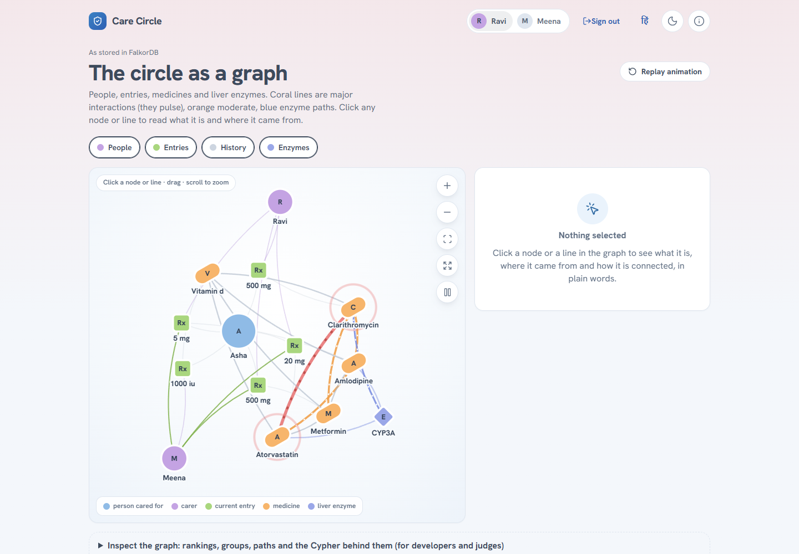
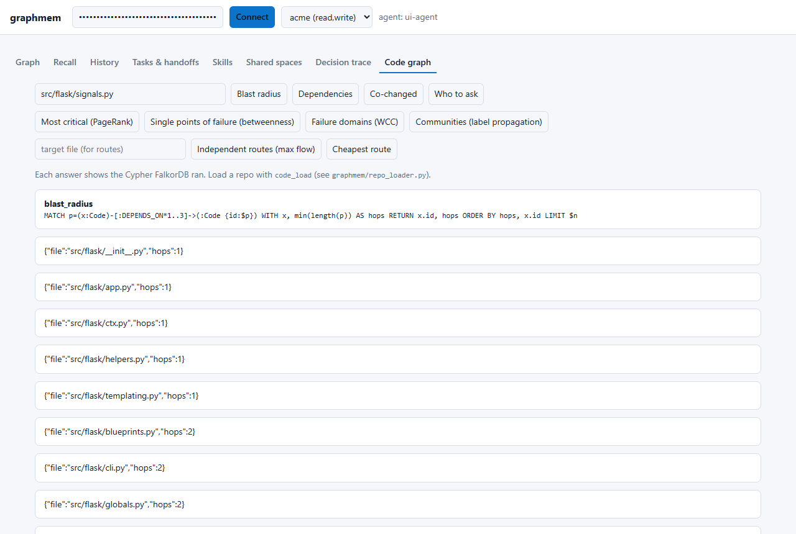

# graphmem - a coordination layer for AI agents, built on FalkorDB

Graph Hacks 2026, Track 02 (Agent Memory & Coordination).

Several coding agents work on one project. They lose each other's context, act on plans whose inputs have since changed, and
cannot explain what they relied on. graphmem keeps all of that in a FalkorDB graph: episodic/semantic/procedural memory, task
handoffs, plans that remember the exact facts they were derived from, a code-structure graph with graph algorithms, and
branch/dry-run/merge of memory using `GRAPH.COPY`. Remove FalkorDB and there is no product: there is no second store.
No LLM key or GPU is needed for the core.

## Run it (one command)

```bash
GRAPHMEM_ADMIN_KEY=change-me docker compose up -d --build     # FalkorDB (append-only volume) + API + UI
open http://localhost:8000          # UI (paste an agent key)        |   http://localhost:3000  FalkorDB Browser (inspect the graph)
```
```bash
python -m venv .venv && .venv/bin/pip install falkordb pytest pytest-asyncio fastapi uvicorn mcp httpx   # Windows: .venv/Scripts
python -m pytest -q                       # 52 tests against a live FalkorDB on :6379
PYTHONPATH=. python demo.py               # handoff + stale plan + decision trace walkthrough
PYTHONPATH=. python bench/proof.py        # 8 end-to-end scenarios
python scripts/seed_demo.py http://127.0.0.1:8000 change-me     # demo tenant through the real admin API
```
Create an agent with `POST /admin/agents`, grant it a tenant with `POST /admin/grants`, and use the returned `gm_...` key as a bearer
token (HTTP) or `GRAPHMEM_API_KEY` (MCP: `python -m graphmem.mcp_server`). Keys are stored only as SHA-256 hashes.

### Use it from Claude Code / any MCP client
```bash
claude mcp add graphmem -e GRAPHMEM_API_KEY=gm_... -e FALKORDB_HOST=localhost -- python -m graphmem.mcp_server
```
Tools: `whoami`, `list_ops`, `call(tenant, op, args_json)`, `remember`, `recall`, `fork_memory`, `fork_call`, `merge_fork`, `discard_fork`,
`space_recall`, `publish_facts`. Walkthrough on a real repo: `PYTHONPATH=. python demo_crew.py path/to/python/repo`.




UI checked end to end in headless Chrome (`scripts/ui_check.py`).

## Graph data model

One graph per tenant (`mem__<tenant>`), a control graph `ctl` for policy, `shared__<space>` graphs for explicit sharing,
`fork__<tenant>__<id>` graphs for branches.

```
mem__<tenant>
  Session <-IN_SESSION- Episode -NEXT-> Episode                  immutable ordered conversation
  Fact -SUBJECT/OBJECT-> Entity ; Fact -EXTRACTED_FROM-> Episode  semantic memory with provenance
  Fact -SUPERSEDES-> Fact (valid_from / valid_to)                 bi-temporal chain
  Fact -INFERRED_FROM-> Fact                                      derived knowledge (lineage)
  Tombstone -TOMBSTONES-> Fact                                    forgetting
  Skill <-OF- Run -FOR-> Task ; Skill -LEARNED_FROM-> Episode     procedural memory (success counters)
  Task -CLAIMED_BY / HANDED_OFF-> Agent                           shared state and handoff chain
  Plan -FOR-> Task ; Plan -DERIVED_FROM-> Fact ; Plan -REVISES-> Plan
  Decision -USED-> Fact | Episode | Plan | Skill                  traceable decisions
  Code -DEPENDS_ON {cap}-> Code ; Code -DEFINES-> Code ; Code -CALLS-> Code      code structure (file / function)
  Person -AUTHORED-> Commit -TOUCHED-> Code                       git history
ctl:  (Agent)-[:GRANTED {scopes}]->(Tenant) ; (Agent)-[:HAS_KEY]->(ApiKey {hash}) ; (Agent)-[:MEMBER]->(Space) ; (Fork)
```

## The graph queries and algorithms the product relies on

Everything below is a real query in `graphmem/` (file and function in the right column).

| Behaviour | Cypher / algorithm | Where |
|---|---|---|
| Atomic ordered append | `MERGE (s:Session) ... SET s.n = s.n+1 ... CREATE (e)-[:NEXT]` in one query | `memory.py add_episode` |
| Create-or-reinforce fact; supersede old value | `MERGE (f:Fact {skey,pred,okey,cur:true})` then `SET old.cur=false ... CREATE (f)-[:SUPERSEDES]->(old)` | `assert_fact` |
| Multi-hop recall with path | `MATCH (en)<-[:SUBJECT\|OBJECT]-(f1)-[:SUBJECT\|OBJECT]->(mid)<-[:SUBJECT\|OBJECT]-(f2)` | `recall` |
| Atomic task claim / handoff | single `MATCH (t:Task) WHERE t.status='open' ... SET ...` (compare-and-set in the WHERE) | `claim_task`, `handoff` |
| Stale plan, including transitive | `(p)-[:DERIVED_FROM]->(f)<-[:SUPERSEDES*1..10]-(n {cur:true})` and `(f)-[:INFERRED_FROM*1..8]->(u {cur:false})` | `check_plan` |
| Skill ranking | `(wins+1)/(runs+2) ORDER BY score` over `Run` counters | `best_skills` |
| Branch memory | `GRAPH.COPY mem__t fork__t__id`, same engine on the fork, dry-run merge compares fork-new facts to tenant changes | `branch.py` |
| Blast radius | `MATCH p=(x:Code)-[:DEPENDS_ON*1..d]->(:Code {id})` | `codegraph.py blast_radius` |
| Dependencies | `algo.BFS` | `dependencies_of` |
| Most critical files | `algo.pageRank('Code','DEPENDS_ON')` | `criticality` |
| Single points of failure | `algo.betweenness` | `single_points_of_failure` |
| Failure domains / communities | `algo.WCC`, `algo.labelPropagation` | `failure_domains`, `communities` |
| Independent routes | `algo.maxFlow` with `capacityProperty` | `failover_capacity` |
| Cheapest route | `algo.SPpaths` | `cheapest_route` |
| Who to ask, what co-changes | `(Person)-[:AUTHORED]->(Commit)-[:TOUCHED]->(Code)` aggregations | `who_to_ask`, `co_changed`, `change_impact` |
| Semantic recall (optional) | `CREATE VECTOR INDEX FOR (f:Fact) ON (f.embedding)` + `CALL db.idx.vector.queryNodes`, fused with graph recall by reciprocal rank | `recall(mode=...)`, `embed.py` |
| Full-text search over conversation | `CREATE FULLTEXT INDEX FOR (e:Episode) ON (e.content)` + `CALL db.idx.fulltext.queryNodes` | `search_text` |
| Authorization | `(Agent)-[:GRANTED]->(Tenant)` read on every query, so revocation is immediate | `policy.py` |

Every code-graph tool returns the Cypher it ran. FalkorDB features used: graph per tenant (multi-graph), indexes, UNIQUE constraints (`GRAPH.CONSTRAINT`), `GRAPH.COPY`,
variable-length paths, `algo.BFS/pageRank/betweenness/WCC/labelPropagation/maxFlow/SPpaths`, `FOREACH`, `UNWIND` bulk loads,
full-text index (`db.idx.fulltext.queryNodes`, `search_text`), vector index (`db.idx.vector.queryNodes`, optional), append-only
persistence.

## Interfaces
HTTP API (FastAPI: bearer auth, admin plane gated by `GRAPHMEM_ADMIN_KEY`, per-agent rate limit, 503 + `Retry-After` when
FalkorDB's queue is full), MCP server (stdio, same operations), web UI at `/` (graph, recall with as-of, history, tasks & handoffs,
skills, decision trace, shared spaces, code graph). The two interfaces share one whitelisted op table (`graphmem/ops.py`).
Branches: `POST /v1/tenants/{t}/forks`, `POST /v1/forks/{id}/{op}`, `POST /v1/forks/{id}/merge` (dry run unless `apply`), `DELETE /v1/forks/{id}`.

## Track 02 requirement -> where it lives
| Requirement | Graph structure | Code / test |
|---|---|---|
| Episodic | `Episode -NEXT-> Episode`, `-IN_SESSION-> Session` | `add_episode`, `history` / `test_episodic_*` |
| Semantic | facts, `SUPERSEDES`, `as_of` queries | `assert_fact`, `recall`, `fact_history` |
| Procedural | `Skill <-OF- Run`; ranking from outcomes | `add_skill`, `record_run`, `best_skills` |
| Persistent history | everything lives in FalkorDB | `test_memory_survives_new_client`, `bench/proof.py` restart scenario |
| Shared state & handoffs | `Task` version + `HANDED_OFF` chain, `Plan -DERIVED_FROM-> Fact` | `claim_task`, `handoff`, `check_plan`, `rebase_plan`, `resume` |
| High concurrency | graph per tenant; atomic single-query transitions | `test_concurrent_writers_*`, `test_claim_race_*`, `bench/http_load.py` |
| Per tenant | graph `mem__<tenant>` + grants checked on every query | `policy.py`, `test_adversarial.py` |
| Traceable decisions | `Decision -USED->` + provenance + path | `record_decision`, `explain` |
| Forgetting | tombstone, value scrubbed, published copies removed | `forget_fact` |

## Measured (see `docs/BENCHMARKS.md` for tables, seeds and caveats)
- **Stale-plan detection (B1, 5 seeds):** graph lineage missed 0 and wasted 0 redos; flat memory missed 54.8 stale plans; a global-version
  OCC baseline wasted 145 redos; per-key versions missed 33.
- **Real git history (B4, click / flask / requests):** co-change + import graph fused beats random by 3-5x on recall@10 and is best or
  near-best in two of three repos; co-change alone wins on click. We do not claim the graph beats history, only that both live in one graph.
- **Load (B7):** 244 -> 448 req/s going from 1 to 4 API processes, 0 failed requests, every acknowledged write verified; survives `docker kill`.
- **Retrieval (B6):** recall@3 on paraphrased questions 0.17 (graph only) -> 1.00 (hybrid); multi-hop 0.50 (graph) vs 0.00 (vector only). Small hand-written set.
- **Isolation (B3):** 6 adversarial tests (forged keys, hostile tenant ids, foreign forks/spaces, injection strings, revocation): 0 leaks.

## Is the graph decoration? (ablation, from the benchmarks above)
Take the graph structure away and the same question gets worse: without `DERIVED_FROM`/`INFERRED_FROM` lineage, flat memory misses 54.8 stale
plans (B1); without fork/merge, last-writer-wins silently overwrites every conflicting write (B2); without the import/co-change graph,
recall@10 for "what changes with this file" falls to random or file-name similarity (B4); without per-tenant graphs and grant edges there
is nothing for the isolation suite to test (B3). A dict-backed reimplementation of the whole product was not built.

## Security notes (what is and is not protected)
Protected: database-level read-only user (set `GRAPHMEM_RO_PASSWORD`: every read-scope operation then runs as a Redis ACL user that may only call `GRAPH.RO_QUERY`, so a bug in a read path cannot write), tenant isolation (separate graphs plus a grant check on every query; revocation is immediate), hashed API keys, parameterised
Cypher everywhere (no string-built queries from user input), only whitelisted operations are callable, rate limits, size caps on forks.
Not protected: stored content can contain prompt-injection text that a downstream LLM may obey (graphmem returns it as data, it never
executes it); rate limiting is per API process; no TLS (put a proxy in front); the admin key is a single shared secret; FalkorDB
ACLs are not per tenant (writes of all tenants share one database credential; the optional read-only user only splits read from write).

## Honest limits
- Extraction: rules (narrow) or an optional OpenAI-compatible LLM (`GRAPHMEM_LLM_URL/MODEL/KEY`); the LLM path is tested only against a fake server.
- Recall is lexical entity matching + graph expansion by default; paraphrases need the optional embeddings (`GRAPHMEM_EMBEDDINGS=1`, `pip install fastembed`, B6). No LoCoMo/LongMemEval numbers are claimed.
- Fork work is additive: edits a fork makes to items that already existed are not merged. Merge is not one atomic transaction.
- Code graph is static Python analysis (imports and bare-name calls); other languages are not parsed.
- All performance numbers are single runs on one Windows laptop. FalkorDB quirk found: `MATCH (a) WHERE ... MATCH (a)-[..]` silently returns no
  rows unless a `WITH a` sits between.

## AI assistance disclosure
This project was designed and written with substantial help from an AI coding assistant (Anthropic's Claude, via Claude Code). Test
runs, benchmark runs and numbers in this repository were produced by running the code in the repository.

## Data
All data is synthetic, generated by the scripts, or public open-source repositories used read-only for the B4 benchmark:
pallets/click and pallets/flask (BSD-3-Clause), psf/requests (Apache-2.0). Nothing private is included.
