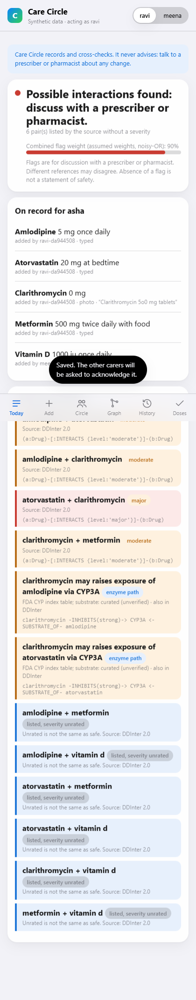

<p align="center">
  
</p>

# Care Circle

**One shared, verified memory of a loved one's medicines, for the family who look after them.**

*Graph Hacks 2026 (WeMakeDevs x FalkorDB), Track 02: Agent Memory & Coordination.*

It is 9 pm. Ravi has just changed his mother's warfarin dose by phone. His sister Meena is on the night shift and has not seen it. Tomorrow a pharmacist adds an antibiotic that interacts with it, and nobody holds the whole picture.

Care Circle keeps that picture in one FalkorDB graph. Each carer reaches it through a web app or Telegram (their own agent identity), adds a medicine by **photo, voice note, PDF/Word or text**, and the circle then knows what is on record, **who has seen each change**, which entries **interact** according to public sources, and which dose slots are **already given**.

**It records and cross-checks. It never advises.** It never says what to take, stop or change. Every flag shows its source and the graph path behind it, and "no flag" is never reported as "safe". All data in the demo is synthetic; no real person's data is used.

Live: **https://3-228-70-117.sslip.io** (press **Start a demo circle**; synthetic data only) · The same memory for any agent: **`POST /mcp`** on the same address ([Connect your agent stack](#connect-an-agent))



## One story it was built around

A cardiologist writes **Telma-AM** (telmisartan with amlodipine). A second doctor, months later, writes plain **amlodipine** for the ankle swelling. On the shelf they are two different boxes; in the body it is amlodipine twice. Care Circle reads the Telma-AM line as *two* ingredients (a hand-written brand list, marked unverified, with "check the pack"), keeps the plain amlodipine as its own entry, and then shows both under the same ingredient with the words "this may be the same medicine from two sources", plus who recorded each and from which quoted line. It says nothing about what to do: the card ends with "discuss with a prescriber or pharmacist". (Browser scenario U14 walks exactly this; `tests/test_duplicates.py` holds the rule.)

## Why it is different

- **It does the daily job.** A written "twice daily" becomes suggested clock times that a person confirms; **Today** then lists each dose slot, who marked it given, and what is not marked yet, and a second carer who taps the same slot is told who got there first. A short course ends on its last day, and a pack count says about how many days of doses are left.
- **One memory for the whole circle.** Not a chat per person: one graph that says what is on record now, what it replaced, and which carer has not yet seen the change.
- **Every flag shows its work.** The source (DDInter 2.0 or the FDA table), the edge it came from, and the exact line of the photo or voice note that produced the entry. A pair the source lists without a severity is shown *unrated*, never "safe".
- **Code decides, AI only structures.** A model may turn OCR or a transcript into *proposed* fields; each proposal's quote must appear in the text that was read, and nothing reaches the regimen until a person confirms it. It never decides an interaction or a dose.
- **The graph holds the record.** Reference knowledge (224,449 interaction pairs, enzyme links), every circle's history, who has seen what, the once-per-slot dose guard and the access grants all live in FalkorDB, one graph per circle.
- **Agents can use the same memory.** An MCP endpoint, LangChain and LlamaIndex tools and graph algorithms (paths, PageRank, betweenness, communities) run on a circle's graph, with the same keys and read-only checks.

Built with Claude as a coding assistant (see [AI use disclosure](#ai-use-disclosure)).

## Try it in two minutes

1. Open the live address and press **Start a demo circle**. Asha takes metformin, amlodipine and atorvastatin; two carers, Ravi and Meena, have both acknowledged them.
2. **Add**, then **Sample label**: a synthetic pharmacy label is read by OCR. You see the proposed entry, the exact line it came from and a *quote verified* badge. Nothing is saved yet. Confirm it.
3. **Today** now flags clarithromycin with atorvastatin as *major*, with the enzyme path behind it. Open the flag to see the source.
4. **Circle**: Meena has not acknowledged the change. Slide the time warp 13 hours: a reminder for Meena, then an escalation to Ravi, each exactly once.
5. **Graph**: watch the circle assemble, click the clarithromycin node and the red line: both explain themselves in words. Open **Inspect the graph** below it for the cards **What the record hangs on** and **What belongs together**: PageRank, betweenness, groups and paths on this circle's own graph (for developers and judges).
6. Point an agent at it: [Connect your agent stack](docs/DETAILS.md#connect-your-agent-stack). The full 90-second script is [The demo story](docs/DETAILS.md#the-demo-story-90-seconds).

## What it does

| Screen | |
|---|---|
| **Today** | One verdict tile (never "safe"), the regimen, and every flag with its source Cypher or enzyme path. |
| **Add** | A photo, voice note, PDF, Word file or typed text becomes proposals with the exact quoted line; a person confirms each one. |
| **Circle** | Who has seen each change, reminders and escalation, and a once-per-slot dose log that refuses a second "given". |
| **Graph** | The circle as a living graph (people, entries, medicines, enzymes); click anything for a plain-words explanation; cards for what the record hangs on, bridges, groups and a path finder. |
| **History** | A look-back slider (what the flags were), a written timeline, FHIR R4 export, and *forget with a receipt*. |
| **Helper** | Answers from the circle's own record, in English or Hindi; declines to advise and points to a prescriber or pharmacist. |
| **Account** | Sign-in (Amazon Cognito on the live site), invitations, quiet hours, browser notifications, a time-limited read-only link for a pharmacist who can leave a note, and a note of whether the person knows about the record. |
| **Telegram** | The same without the app: photo, voice, text, `/regimen`, `/check`, `/history`, `/ack`, `/gave`. |

Every number and flag says where it came from, and when the sources disagree or are missing the app says so rather than guessing. Details of each part are in [`docs/DETAILS.md`](docs/DETAILS.md).

## Connect an agent

The same memory is open to any agent: `POST /mcp` on the live address (Streamable HTTP, `Authorization: Bearer <key>`), or the stdio server `python -m graphmem.mcp_server`, or the LangChain and LlamaIndex tools in `integrations/`. Keys carry scopes (`read`, `write`, `admin`) that are enforced before every operation. Setup, tool list and examples: [Connect your agent stack](docs/DETAILS.md#connect-your-agent-stack).

On the question this memory exists to answer ("which carer has not seen which change?") on 20 generated circles: Care Circle 20/20, Mem0 7/20, a model given every event 10/20; and in a race of ten callers for one dose slot Care Circle accepts one, Mem0 all ten. Tiny circles, one question, untuned baselines: read the limits in `docs/BENCHMARKS.md` (B6) before quoting it.

## Safety by design
- **No advice.** A scanner (`carecircle/safety.py`) rejects outgoing text that tells someone to take, stop, skip or change a dose. Messages are
  templates whose facts (drug, hours, carer) are checked before sending.
- **Refuses to judge.** States are `no_data`, `partial`, `flags` or `no_known_conflict`; the last always says "this is not a statement of safety".
- **Quote and verify.** The model only structures text the OCR/ASR already read. Each quote must appear in that text; otherwise the entry stays
  *pending* and never reaches the regimen or the checks until a person confirms it. Every proposal needs a person's confirmation.
- **Unknown stays unknown.** 26% of DDInter pairs have severity "Unknown": shown as *unrated*.

## Limits, stated plainly
- Interaction severity weights (minor .1, moderate .3, major .7; enzyme strong .7, moderate .3; staleness half-life 72 h) are **assumptions**, not clinical values.
- The FDA CYP table is an index list, not exhaustive. Sources may disagree. Flags are for discussion with a prescriber or pharmacist.
- **The enzyme layer is small.** The enzyme-path check rests on the FDA's table of index CYP inhibitors, inducers and substrates: 7 enzymes, 13 inhibitors, 7 inducers and 12 substrates, plus 9 substrates from a short hand-made list that is marked `curated (unverified)` wherever it appears. Together they touch **32 of the 1,833 medicines** in the reference graph. The FDA page also lists *laboratory (in vitro)* inhibitors, inducers and transporter findings (P-gp, OATP, OAT, OCT2, MATE, BCRP); those add 31 more medicines (63 in all) as the weakest kind of flag: labelled "a laboratory finding, not shown in people", given the lowest weight, shown as minor, and never shown instead of a clinical path for the same pair. When the FDA site refuses the scripted download (it did in CI), the loader uses the copy of that page bundled in `carecircle/snapshot/`. A medicine outside those gets no enzyme-path flag; its interactions come only from the DDInter pairs. **No flag is never a statement that nothing interacts.**
- The Telegram bot is tested against a fake Telegram API and, by hand, live (`/link`, `/regimen`, a typed medicine, Confirm, `/check`, a photo of a label, a reminder arriving after a back-dated unseen change, `/ack`); a spoken note, where Whisper heard "Arferin" and the matcher still offered warfarin first, with the heard text shown for a person to confirm. Voice uses a local Whisper `base` model; accuracy varies with accent and noise.
- Anthropic models on Bedrock were unavailable on the account used (verification pending), so the default structuring model is Amazon Nova; rules work without any model.
- Cognito's default email sender is capped at 50 messages a day, so sign-ups beyond that need Amazon SES. The Telegram link-by-code and the account pages were tested against the fake API and in Chrome, not yet live in Telegram. The helper has not been evaluated with real families: its refusal rules are keyword-based and can miss an unusual phrasing, which is why every answer is also checked for advice before it is sent.
- Reminders arrive by browser notification (Web Push) and Telegram. WhatsApp and SMS are **not built**: they need a paid sender account and a phone number per person, which this project avoids. The interface is English and Hindi; other languages need a translator to review them before they are added.
- **Where the data comes from limits where it can be used.** Interaction severities come from DDInter 2.0 (US/EU-centred drug labelling and literature) and the FDA CYP table; they are not a view of how Indian practice rates the same pairs, and many Indian brands are combinations the reference data has never heard of (the combination list in `carecircle/brands.py` is hand-written and unverified). Recalls come from openFDA, which lists US recalls only, so they are looked up only for a circle in a US time zone.
- **Not for commercial use as it stands.** DDInter is CC BY-NC-SA 4.0. A commercial service would need a licence for an interaction source (or its own curated one), a licensed brand-to-ingredient master for India, clinician review of every rule, and the regulatory and privacy steps for health data (in India, the DPDP Act, including the patient's own consent, which this project records only as a note and not as legal consent).
- Per-process rate limiting; TLS comes from Caddy in the production compose only (the dev compose has none); one shared database credential across circles; a single server with no replica (S3 snapshots every 6 hours are the recovery path).

## Data and licences
Interaction data: **DDInter 2.0**, CC BY-NC-SA 4.0 (**non-commercial** use; attribution required), downloaded by `scripts/fetch_reference.py`, not stored in this repository.
Enzyme data: the FDA "Drug Development and Drug Interactions" substrates/inhibitors/inducers table. A snapshot of the FDA table (US government work) is bundled in `carecircle/snapshot/` as a fallback when the FDA site blocks scripted downloads. Demo circles, labels and people are synthetic.

## AI use disclosure
This project was built with substantial help from Claude (Anthropic) via Claude Code: design discussion, code, tests and docs were written with
AI assistance and reviewed and run by the author. At runtime, an optional Amazon Bedrock model (Amazon Nova) only turns OCR/transcript text into
proposed fields; it never decides interactions or doses.

**Commits carry no AI co-author line.** The git history lists the author only, and no "Co-Authored-By" trailer for Claude or any other assistant appears on any commit or pull request on GitHub; AI assistance is disclosed here, in the README, instead. Contributors should keep it that way: write the commit message as the author and leave assistant trailers out.

## Run it
Deployed on one AWS EC2 instance (t3.large, Docker Compose, Caddy for HTTPS, Bedrock through the instance role, only ports 80/443 open): `deploy/docker-compose.prod.yml`.

```bash
# everything: FalkorDB (append-only volume) + app. First start downloads the public reference data and loads it (a few minutes).
GRAPHMEM_ADMIN_KEY=change-me docker compose up -d --build
open http://localhost:8000          # press "Start a demo circle"     (FalkorDB Browser: http://localhost:3000)
```
Without Docker (needs a FalkorDB on :6379, e.g. `docker run -p 6379:6379 falkordb/falkordb`):
```bash
python -m venv .venv && .venv/bin/pip install -r requirements.txt          # Windows: .venv/Scripts
python scripts/fetch_reference.py                                           # DDInter + FDA tables into data/ref (gitignored)
python -c "from carecircle import reference as r; print(r.load())"          # build the shared cc_ref graph
(cd web && npm ci && npm run build)                                         # the React app (served by the API from web/dist)
python -m graphmem.api                                                      # http://127.0.0.1:8000
python -m pytest -q tests                                                   # the whole suite, against a live FalkorDB
(cd web && npm test)                                                        # UI unit tests; `npm run dev` for hot reload (proxies to :8000)
PORT=8000 python scripts/ui_e2e.py && PORT=8000 python scripts/ui_e2e_accounts.py    # browser walk-throughs: demo, then accounts (need Chrome and `pip install playwright`)
PYTHONPATH=. python bench/care_bench.py                                     # benchmarks below (`--out run.json`, then `python bench/gate.py bench/baselines/care_bench.json run.json` compares two runs)
```
Optional: `CC_COGNITO_POOL_ID` / `CC_COGNITO_CLIENT_ID` (email sign-up through Amazon Cognito; unset = built-in accounts), `CC_ASSISTANT=0` (the helper answers from rules only), `CC_MODEL` / `AWS_REGION` + AWS credentials let Amazon Bedrock (default `us.amazon.nova-pro-v1:0`) structure what the OCR read;
`CC_LLM=0` or no credentials falls back to rules. Set `TELEGRAM_BOT_TOKEN` to also run the Telegram bot in the server process (`/link <key> <circle>`, then send a photo, voice note or text).

**Look inside the graph.** `python scripts/seed_explore.py` loads two small synthetic graphs (a care circle and an agent's memory); then open FalkorDB Browser at <http://localhost:3000>, connect to `localhost:6379`, and run the queries in [`docs/EXPLORE.md`](docs/EXPLORE.md): the regimen and its history, who has not seen a change, why an agent decided something, and PageRank over the interaction graph. A test runs every query in that guide, so they work. The live site does not expose the Browser (one login would show every family's circle); the Graph tab shows each circle's own graph and the Cypher behind it.

## More detail

The full technical write-up lives in [`docs/DETAILS.md`](docs/DETAILS.md), one section each:

- [Where FalkorDB fits](docs/DETAILS.md#where-falkordb-fits)
- [Why the graph is the product](docs/DETAILS.md#why-the-graph-is-the-product)
- [Three graphs, on purpose](docs/DETAILS.md#three-graphs-on-purpose)
- [Graph data model](docs/DETAILS.md#graph-data-model)
- [Queries and algorithms](docs/DETAILS.md#queries-and-algorithms)
- [Connect your agent stack](docs/DETAILS.md#connect-your-agent-stack)
- [Accounts, circles and the helper](docs/DETAILS.md#accounts-circles-and-the-helper)
- [More than medicines](docs/DETAILS.md#more-than-medicines)
- [What is in the app](docs/DETAILS.md#what-is-in-the-app)
- [The demo story (90 seconds)](docs/DETAILS.md#the-demo-story-90-seconds)
- [Measured (one laptop; B-series and load test repeated 7 times each, see `docs/BENCHMARKS.md`)](docs/DETAILS.md#measured-one-laptop-b-series-and-load-test-repeated-7-times-each-see-docsbenchmarksmd)
- [What runs, and how it is checked](docs/DETAILS.md#what-runs-and-how-it-is-checked)
- [Operations](docs/DETAILS.md#operations)
- [Layout](docs/DETAILS.md#layout)

Other documents: [`docs/HAZARDS.md`](docs/HAZARDS.md) (what can go wrong and the test behind each), [`docs/BENCHMARKS.md`](docs/BENCHMARKS.md), [`docs/SCENARIOS.md`](docs/SCENARIOS.md), [`docs/API.md`](docs/API.md), [`docs/TRACK02.md`](docs/TRACK02.md). How many tests and scenarios there are right now: `python scripts/counts.py` (the number is produced, not typed here).
