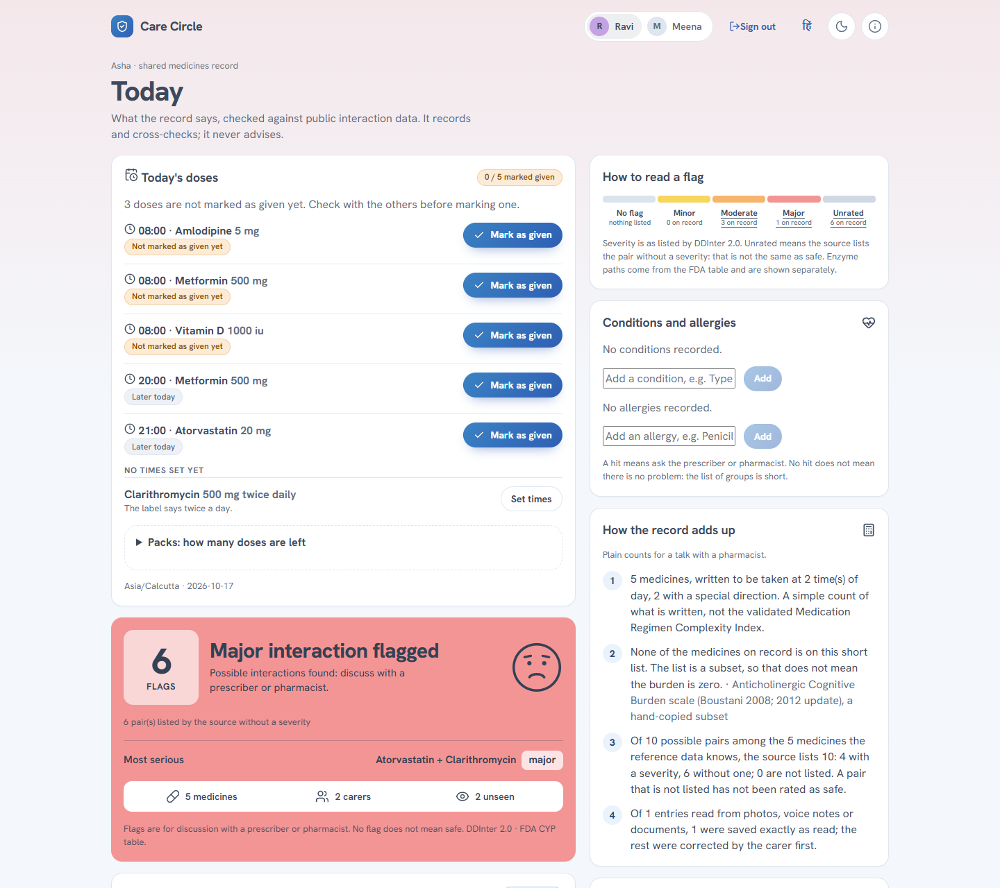
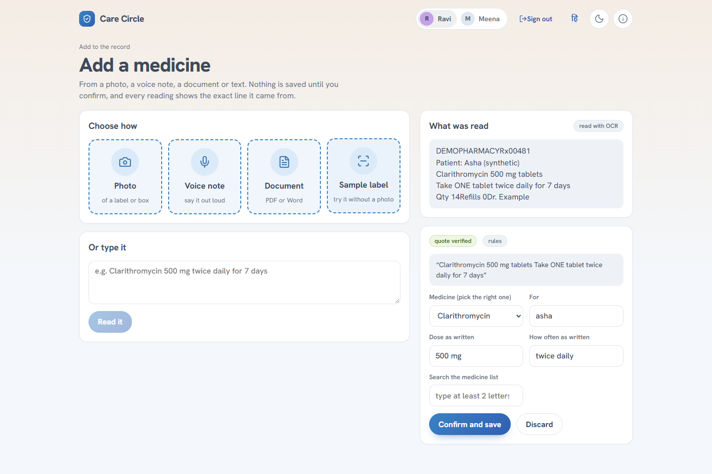
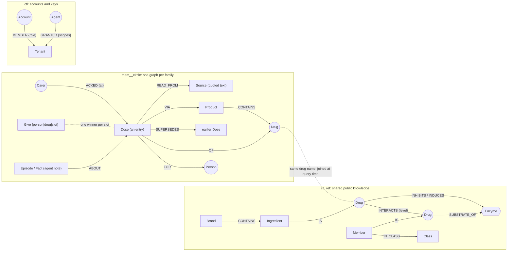

<p align="center">
  
</p>

# Care Circle

**Closing the loop, for the family who look after a loved one and the agents that work beside them.** One shared memory of their medicines: what is on record, who has seen each change, and what an agent noted about it. *Graph Hacks 2026 (WeMakeDevs x FalkorDB), Track 02: Agent Memory & Coordination.*

**What it is for.** When several family members look after one person's medicines, nobody has the full picture: a dose is changed by phone, someone is on a night shift, a second doctor adds a tablet. Care Circle gives the family one shared list. Anyone can add a medicine by photo, voice note, PDF/Word or text (on the web or in Telegram). Everyone can then see what the person takes, who has seen each change, which medicines are known to interact according to public sources, and which of today's doses have already been given.

**It records and cross-checks. It never advises.** It never says what to take, stop or change; every flag shows its source and the graph path behind it, and "no flag" is never reported as "safe". All demo data is synthetic.

Live: **https://3-228-70-117.sslip.io** (press **Start a demo circle**) · The same memory for any agent: **`POST /mcp`** on the same address ([Connect an agent](docs/DETAILS.md#connect-your-agent-stack))



## The story it was built around

It is 9 pm. Ravi has just changed his mother's warfarin dose by phone. His sister Meena is on the night shift and has not seen it. Tomorrow a pharmacist adds an antibiotic that interacts with it, and nobody holds the whole picture. Care Circle keeps that picture in one FalkorDB graph: carers add a medicine by **photo, voice note, PDF/Word or text** (web app or Telegram), and the circle knows what is on record, **who has seen each change**, which entries **interact** according to public sources, and which dose slots are **already given**.

A cardiologist writes **Telma-AM** (telmisartan with amlodipine). A second doctor, months later, writes plain **amlodipine** for the ankle swelling. On the shelf they are two boxes; in the body it is amlodipine twice. Care Circle reads the Telma-AM line as *two* ingredients (a hand-written brand list, marked unverified, with "check the pack"), keeps the plain amlodipine as its own entry, and shows both under the same ingredient: "this may be the same medicine from two sources", with who recorded each and the quoted line. It says nothing about what to do. (Browser scenario U14 walks it; `tests/test_duplicates.py` holds the rule.)

## Handoffs without the hand-wringing (the Track 02 demo, 60 seconds)

At night, one agent records a dose change and writes a **note about that entry** (why it changed). In the morning a **different agent, with its own key, in a new session**, asks what it knows about warfarin and gets the note back **with the path to the entry**. Before acting it checks who has not seen the change: Meena has not, so it **holds off** until she presses "I have seen this", then proceeds and attaches its own note. The notes never change a dose, a flag or the history; they are labelled *"noted by night-agent, unverified"*.

```bash
python scripts/agent_memory_demo.py --url http://localhost:8099 --admin-key ADMIN      # two real MCP clients, two keys, one throwaway circle
```

The same story runs in CI (`tests/test_agent_memory_demo.py`). The helper that answers carers reads its own conversation too: "and what about Ravi?" and "why is the second one flagged?" are read against what it just said, and when it cannot tell which one is meant it asks.

## Why it is different

- **It does the daily job.** "Twice daily" becomes suggested clock times a person confirms; **Today** lists each slot, who gave it, and a second carer who taps the same slot is told who got there first.
- **One memory for the whole circle**, not a chat per person: what is on record now, what it replaced, which carer has not yet seen the change.
- **Every flag shows its work**: the source (DDInter 2.0 or the FDA table), the graph edge, and the exact line of the photo or voice note. An unrated pair is shown *unrated*, never "safe".
- **Code decides, AI only structures.** A model may turn OCR text into *proposed* fields; each quote must appear in the text that was read, and nothing reaches the regimen until a person confirms it. The photo itself is never sent to a model.
- **Agents can use the same memory**: MCP, LangChain and LlamaIndex tools, and graph algorithms on a circle's graph, with the same keys and read-only checks. An agent's note about an entry sits beside it, labelled unverified, and can never rewrite what a carer confirmed.



More screens (flags, the circle as a graph, who has seen what, history): [`docs/SCREENSHOTS.md`](docs/SCREENSHOTS.md).

## Try it in two minutes

1. Open the live address, press **Start a demo circle** (Asha takes metformin, amlodipine and atorvastatin; carers Ravi and Meena have acknowledged them).
2. **Add → Sample label**: OCR reads a synthetic label; you see the proposed entry, the quoted line and a *quote verified* badge. Confirm it.
3. **Today** flags clarithromycin with atorvastatin as *major*, with the enzyme path behind it. **Circle**: Meena has not acknowledged the change; slide the time warp 13 hours to see a reminder, then an escalation, each exactly once.
4. **Graph**: click the clarithromycin node and the red line; both explain themselves in words. The full 90-second script is [The demo story](docs/DETAILS.md#the-demo-story-90-seconds).
5. **The coordination story, in order of how much it shows**: [the agent demo](#handoffs-without-the-hand-wringing-the-track-02-demo-60-seconds) above; **Circle** (who has not seen what, handover notes addressed to a carer who accepts them); **Today** (one tick per tablet, one winner per slot); an entry's *Show what it was read from* (the notes agents wrote about it, and the reminders sent about it).

## Safety by design

- **No advice.** A scanner (`carecircle/safety.py`) rejects outgoing text that tells someone to take, stop, skip or change a dose; messages are templates whose facts are checked before sending.
- **Refuses to judge.** States are `no_data`, `partial`, `flags` or `no_known_conflict`; the last always says "this is not a statement of safety".
- **Quote and verify.** The model only structures text the OCR already read; a quote not found in it leaves the entry *pending* until a person confirms it. 26% of DDInter pairs have severity "Unknown": shown as *unrated*.
- What can go wrong, and the test behind each: [`docs/HAZARDS.md`](docs/HAZARDS.md). The review's own probes, run again: [`docs/REVIEW_PROBES.md`](docs/REVIEW_PROBES.md).

## Graph data model

Three graphs (FalkorDB): `cc_ref` is shared public knowledge, `mem__<circle>` is one graph per family, `ctl` holds accounts and keys. Full model with every property: [`docs/DETAILS.md`](docs/DETAILS.md#graph-data-model).



Read it as: a medicine entry (`Dose`) in a family's graph points at a `Drug`; the same drug in the shared graph carries the interactions and enzyme paths, so a flag is that join. Who has seen a change is an `ACKED` edge from a carer, and the dose-slot guard is one `Give` node per slot.

```
cc_ref    (Drug {name}) -[:INTERACTS {level, source}]-> (Drug)           ~218,000 DDInter pairs
          (Drug) -[:HAZARD {w}]-> (Drug)                                 moderate/major only, for algorithms
          (Drug) -[:INHIBITS|INDUCES {strength}]-> (Enzyme) <-[:SUBSTRATE_OF]- (Drug)     FDA CYP table
          (Brand)-[:CONTAINS {pos}]->(Ingredient)-[:IS]->(Drug)          combination brands
          (Member)-[:IN_CLASS]->(Class)  (Member)-[:IS]->(Drug)          allergy classes (WHO ATC)

mem__<circle>
          (Person)  (Dose {drug, dose_text, freq_text, valid_from, valid_to, cur, status, source_type, quote})
          (Dose)-[:FOR]->(Person)  (Dose)-[:OF]->(Drug)  (Dose)-[:SUPERSEDES]->(Dose)
          (Dose)-[:VIA]->(Product {key, name, combo, strength, slots})-[:CONTAINS]->(Drug)
          (Carer)-[:ACKED {at}]->(Dose)        who has seen which entry
          (Give {key: person|drug|slot})       one per dose slot: the double-dose guard
          (Episode)-[:ABOUT]->(Dose|Person)    notes and facts agents write, kept apart from the record
          (Source)<-[:READ_FROM]-(Dose)        the text an entry was read from

ctl       (Account)-[:MEMBER {role}]->(Tenant)   (Agent)-[:GRANTED {scopes}]->(Tenant)   (Session)  (Invite)
```

## Cypher queries and graph algorithms the product depends on

| What it does | Query / algorithm | Code |
|---|---|---|
| Interactions in a regimen | `MATCH (x:Drug)-[m:INTERACTS]-(y:Drug) WHERE x.name IN $d AND y.name IN $d` | `carecircle/checks.py` |
| Enzyme path (2 hops) | `(x)-[:INHIBITS\|INDUCES]->(e:Enzyme)<-[:SUBSTRATE_OF]-(y)` | `carecircle/checks.py` |
| Allergy class to packs and interactions | `(Member)-[:IN_CLASS]->(Class)`, `(Member)-[:IS]->(Drug)`, `(Brand)-[:CONTAINS]->(Ingredient)-[:IS]->(Drug)` | `carecircle/checks.py` |
| Atomic one-winner dose claim | `MERGE (g:Give {key:$k}) ON CREATE SET g.won = true` then `SET g.won = false` | `graphmem/care.py` `care_give` |
| Who has not seen a change | absence of `(:Carer)-[:ACKED]->(:Dose)` per carer, age-weighted | `graphmem/care.py` |
| History and "what did we know then?" | `valid_from <= $t AND (valid_to IS NULL OR valid_to > $t)` over `SUPERSEDES` chains | `graphmem/care.py` `care_regimen` |
| Duplicate medicines | current `Dose` grouped on the `Drug` they are `OF`, groups of 2+ | `graphmem/care.py` `care_duplicates` |
| Reminder sent once | `MERGE (n:Nudge {key:$k}) ON CREATE SET n.fresh = true` | `graphmem/care.py` |
| Access check on every query | `(Agent)-[:GRANTED]->(Tenant)` | `graphmem/policy.py` |
| Hub medicines | `CALL algo.pageRank('Drug','HAZARD')` | `carecircle/algos.py` |
| Hazard clusters | `CALL algo.WCC({nodeLabels:['Drug'], relationshipTypes:['HAZARD']})` | `carecircle/algos.py` |
| Flag order | severity, then connectedness inside this person's `HAZARD` subgraph (`order_flags`) | `carecircle/algos.py` |
| Shared enzyme / transporter groups | medicines on record grouped by the `Enzyme` they share (`group_pathways`) | `carecircle/algos.py` |
| Who the record depends on | weighted graph of carer to entries (`care_dependence`) | `graphmem/care.py` |
| Agent graph tools | `algo.pageRank`, `algo.HarmonicCentrality`, `algo.WCC`, `algo.labelPropagation`, shortest path, neighbourhood on a circle's own graph | `graphmem/graph_algos.py` |

Every table of queries with the test that checks each one: [`docs/DETAILS.md`](docs/DETAILS.md#queries-and-algorithms).

## Data and licences

Interaction data: **DDInter 2.0**, CC BY-NC-SA 4.0 (**non-commercial**; attribution required), downloaded by `scripts/fetch_reference.py`, not stored in this repository. Enzyme data: the FDA drug-interaction table (a US government snapshot is bundled in `carecircle/snapshot/` as a fallback), and allergy classes from WHO ATC via NLM RxClass. Demo circles, labels and people are synthetic.

## AI use disclosure

This project was built with help from Claude (Anthropic) via Claude Code: design discussion, code, tests and docs were written with AI assistance and reviewed and run by the author. At runtime, an optional Amazon Bedrock model (Amazon Nova Pro by default; `CC_MODEL` can name another) only turns OCR/transcript text into proposed fields; it never decides interactions or doses.

## Run it

Deployed on one AWS EC2 instance (Docker Compose, Caddy for HTTPS, Bedrock through the instance role), described by one CloudFormation template; operations in full: [`docs/DETAILS.md`](docs/DETAILS.md#operations).

```bash
GRAPHMEM_ADMIN_KEY=change-me docker compose up -d --build     # FalkorDB + the app; the first start loads the public reference data (a few minutes)
open http://localhost:8000                                    # press "Start a demo circle"
python -m pytest -q tests                                     # the whole suite, against a live FalkorDB
```

Without Docker, every setting (Cognito, model, cookie sessions, database password, reminders, Telegram) and how to look inside the graph: [Running it and settings](docs/DETAILS.md#running-it-and-settings).

## More detail

The full write-up is [`docs/DETAILS.md`](docs/DETAILS.md) (where FalkorDB fits, the graph model, queries and algorithms, agents, what is in each screen, the 90-second demo, measurements, operations). Also: [`docs/BENCHMARKS.md`](docs/BENCHMARKS.md), [`docs/SCENARIOS.md`](docs/SCENARIOS.md), [`docs/API.md`](docs/API.md), [`docs/TRACK02.md`](docs/TRACK02.md). How many tests and scenarios there are right now: `python scripts/counts.py` (produced, not typed here).
