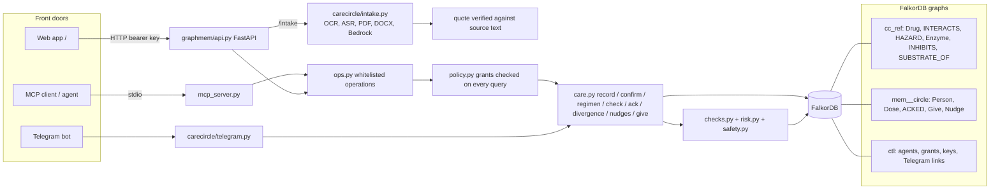
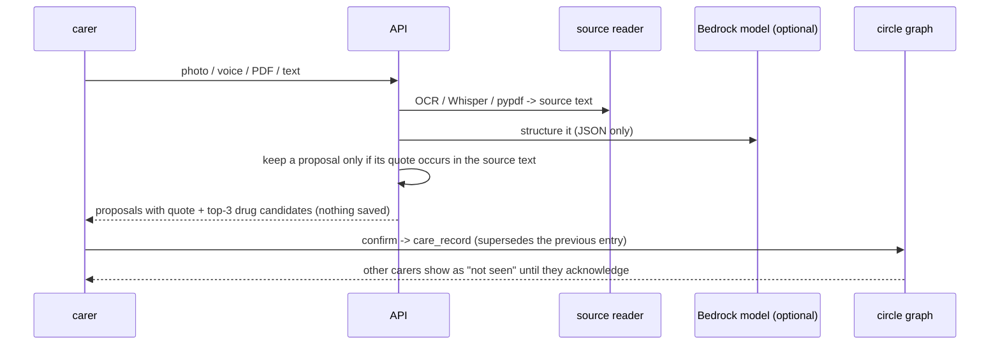

# Architecture

Request path: key -> `ctl` lookup (agent) -> op whitelist -> grant check (`read`/`write`/`admin`) -> parameterised Cypher on the
circle's graph (retried only on FalkorDB's "queue full" error, 503 if it persists). Interaction checks read the shared `cc_ref` graph, which no request can write.

## Intake path

## Why one graph per circle
Hard isolation (no tenant filter to forget in a query) and FalkorDB serializes writes per graph, so circles write in parallel.
Reference knowledge is shared once in `cc_ref` instead of copied into every circle.
