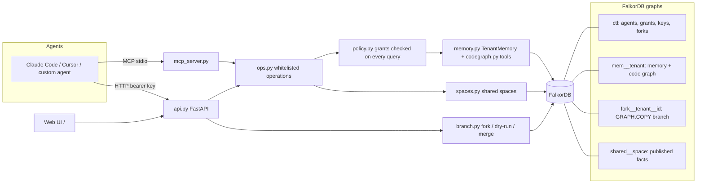
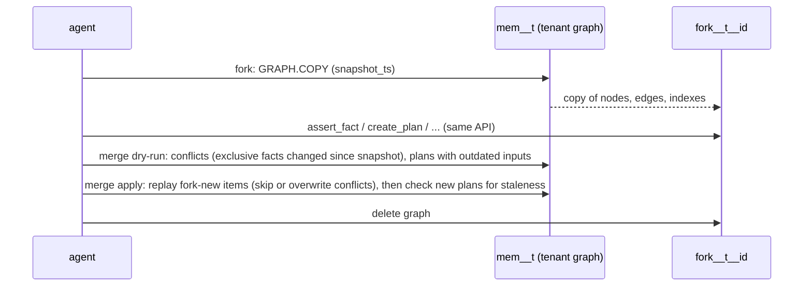

# Architecture

Request path: key -> `ctl` lookup (agent) -> op whitelist -> grant check (`read`/`write`/`admin`) -> parameterised Cypher on the
tenant's graph (retried only on FalkorDB's "queue full" error, 503 if it persists).

## Merge flow

## Why one graph per tenant
Hard isolation (no tenant filter to forget in a query) and FalkorDB serializes writes per graph, so tenants write in parallel
(2.36x on heavy writes in our spike, see `docs/DECISION.md`). One hot tenant with many writers is bounded by single-graph write
speed; batch writes (`UNWIND`) for that case.
