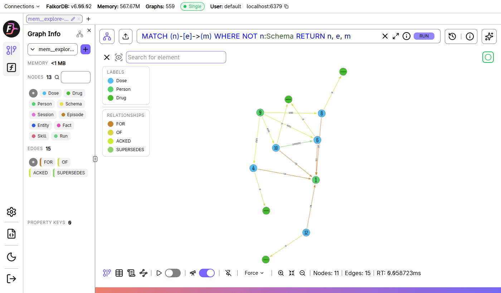
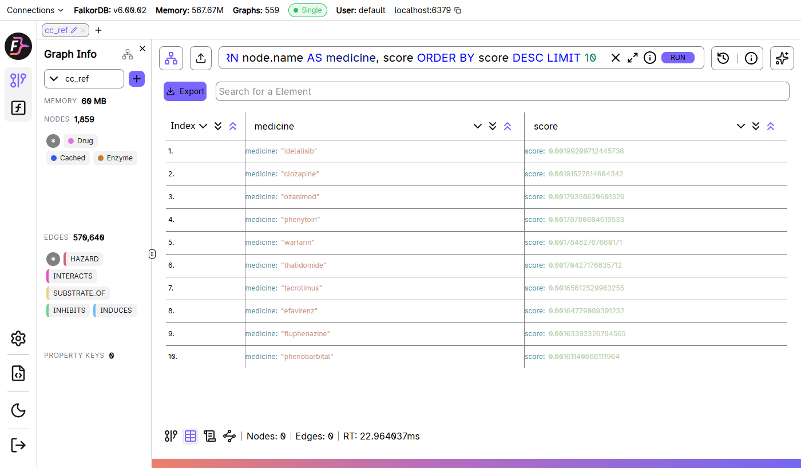
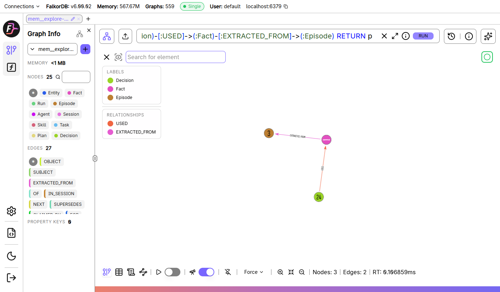

# Explore the graph in FalkorDB Browser

Every record in Care Circle and in the agent memory is an ordinary FalkorDB graph, so you can open it in FalkorDB Browser, run Cypher against it and see how the records connect. Nothing here is a mock-up: the queries below are run by `tests/test_explore_queries.py` against the seeded data, so the guide cannot drift from the real data model.

## 1. Open it (about two minutes)

```
docker compose up -d                  # FalkorDB on :6379 and its Browser on :3000
python scripts/seed_explore.py        # two small synthetic graphs, invented data only
```

1. Open <http://localhost:3000>. On the login page enter host `localhost`, port `6379`, leave user and password empty, press **Log in**. (The Browser runs inside the same container as the database, so `localhost` is the database.)
2. Press **Select Graph** and pick one of the graphs below. Paste a query into the box and press **Run**. Use the table icon at the bottom for rows, the graph icon for the drawing.

| Graph | What it holds |
|---|---|
| `mem__explore-circle` | a care circle: a person, two carers, medicines and doses, one dose that was changed, one change a carer has not seen |
| `mem__explore-agents` | agent memory: a session of events, facts that were superseded, a skill with runs, a task that was handed off, a plan, a decision |
| `cc_ref` | the public reference graph: 1,833 medicines, 224,449 interaction pairs (DDInter 2.0, CC BY-NC-SA 4.0), enzymes. Loaded on first start |

Real circles are graphs named `mem__<circle id>`; the control graph `ctl` holds accounts and grants (hashes only, never keys or passwords). One graph per circle is the isolation: a query can only reach the graph it is run on.



## 2. The care circle, `mem__explore-circle`

The whole circle as a drawing (people, doses, medicines, who has seen what):

```cypher
// graph: mem__explore-circle
MATCH (n)-[e]->(m) WHERE NOT n:Schema RETURN n, e, m
```

What is on record now. `cur` is the entry that currently counts; an older entry stays in the graph with the entry that replaced it:

```cypher
// graph: mem__explore-circle
MATCH (d:Dose {cur: true, status: 'confirmed'})-[:FOR]->(p:Person)
RETURN d.drug AS medicine, d.dose_text AS dose, d.freq_text AS when_taken, p.id AS person ORDER BY medicine
```

How a dose changed over time (`SUPERSEDES` is the history; nothing is overwritten):

```cypher
// graph: mem__explore-circle
MATCH (new:Dose)-[s:SUPERSEDES]->(old:Dose) RETURN new, s, old
```

Who has not seen a change. A carer has seen an entry when an `ACKED` edge runs from them to it; the absence of that edge is the answer:

```cypher
// graph: mem__explore-circle
MATCH (c:Person {role: 'carer'}), (d:Dose {cur: true})
WHERE NOT (c)-[:ACKED]->(d) AND d.by <> c.id
RETURN c.id AS carer, d.drug AS has_not_seen, d.dose_text AS dose, d.by AS recorded_by
```

From the person to a medicine, as a path:

```cypher
// graph: mem__explore-circle
MATCH p = (:Person {id: 'asha'})<-[:FOR]-(:Dose {cur: true})-[:OF]->(:Drug) RETURN p
```

## 3. The reference graph, `cc_ref`

Major interactions of one medicine:

```cypher
// graph: cc_ref
MATCH (a:Drug {name: 'clarithromycin'})-[i:INTERACTS]-(b:Drug) WHERE i.level = 'major' RETURN a, i, b LIMIT 25
```

The pair the circle above triggers. The app shows this edge, with its source, when it flags the pair:

```cypher
// graph: cc_ref
MATCH (a:Drug {name: 'clarithromycin'})-[i:INTERACTS]-(b:Drug {name: 'warfarin'}) RETURN a, i, b
```

An enzyme path: one medicine slows the enzyme that clears another:

```cypher
// graph: cc_ref
MATCH (x:Drug)-[:INHIBITS]->(e:Enzyme)<-[:SUBSTRATE_OF]-(y:Drug {name: 'warfarin'}) RETURN x, e, y LIMIT 25
```

## 4. Graph algorithms, run by FalkorDB



PageRank over moderate and major pairs: the medicines that sit in the most hazards.

```cypher
// graph: cc_ref
CALL algo.pageRank('Drug', 'HAZARD') YIELD node, score RETURN node.name AS medicine, score ORDER BY score DESC LIMIT 10
```

Connected components over the same pairs: how many separate groups there are, and how large.

```cypher
// graph: cc_ref
CALL algo.WCC({nodeLabels: ['Drug'], relationshipTypes: ['HAZARD']}) YIELD node, componentId
RETURN componentId, count(node) AS size ORDER BY size DESC LIMIT 5
```

The same family of calls works on a memory graph; the app and agents reach them as the operations `graph_influence`, `graph_communities`, `graph_path` and `graph_neighbourhood` (README, "Graph data model"). Harmonic centrality on the agent memory: which records reach the rest of the graph fastest, following the links.

```cypher
// graph: mem__explore-agents
CALL algo.HarmonicCentrality({}) YIELD node, score WHERE NOT node:Schema
RETURN labels(node)[0] AS kind, coalesce(node.name, node.title, node.summary, node.id) AS record, score ORDER BY score DESC LIMIT 5
```

## 5. Agent memory, `mem__explore-agents`

A decision, the fact it used and the event that fact was read from (the "why did the agent do that" query, drawn by the Browser):



Everything at a glance: events, the facts taken from them, who wrote what, the skill, the task:

```cypher
// graph: mem__explore-agents
MATCH (n)-[e]->(m) WHERE NOT n:Schema AND NOT m:Schema RETURN n, e, m
```

Where each fact came from. Every fact links to the event it was read from, so "why do we believe this" is one hop:

```cypher
// graph: mem__explore-agents
MATCH (f:Fact)-[:EXTRACTED_FROM]->(e:Episode)
RETURN f.sname AS subject, f.pred AS predicate, f.otext AS object, f.cur AS current, e.content AS read_from ORDER BY f.recorded_at
```

What we believed, and what replaced it. The old fact is closed, not deleted, so "what did we think on Tuesday" can still be answered:

```cypher
// graph: mem__explore-agents
MATCH (new:Fact)-[s:SUPERSEDES]->(old:Fact) RETURN new, s, old
```

Why an agent decided something: the decision, the facts it used, the events those came from:

```cypher
// graph: mem__explore-agents
MATCH p = (d:Decision)-[:USED]->(:Fact)-[:EXTRACTED_FROM]->(:Episode) RETURN p
```

A handoff: the task, who it went to, and the plan that came with it:

```cypher
// graph: mem__explore-agents
MATCH (t:Task)-[h:HANDED_OFF]->(a:Agent) OPTIONAL MATCH (p:Plan)-[:FOR]->(t) RETURN t, h, a, p
```

Skills ranked by how often they worked (smoothed, so one lucky run does not win):

```cypher
// graph: mem__explore-agents
MATCH (s:Skill) RETURN s.name AS skill, s.wins AS wins, s.runs AS runs, toFloat(s.wins + 1) / (s.runs + 2) AS smoothed ORDER BY smoothed DESC
```

## 6. Two things to know

- **The live site does not expose FalkorDB Browser.** The Browser has one login for the whole database, so on a server holding many families' circles it would show all of them. The live site gives each person their own door instead: their circle's **Graph** tab draws the graph and shows the Cypher behind each list, and `POST /v1/tenants/{circle}/{op}` and `/mcp` run the same read-only graph operations, each limited to the circles that key may read. Run the Browser locally against the synthetic data above.
- **The queries here only read.** If you type a write into the Browser against a graph you care about, it will run. Seed a throwaway database for exploring.
