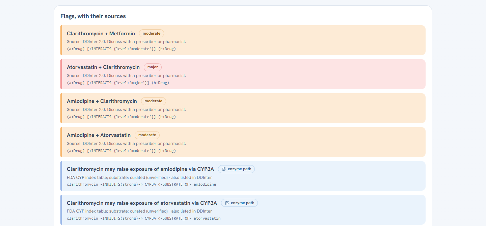
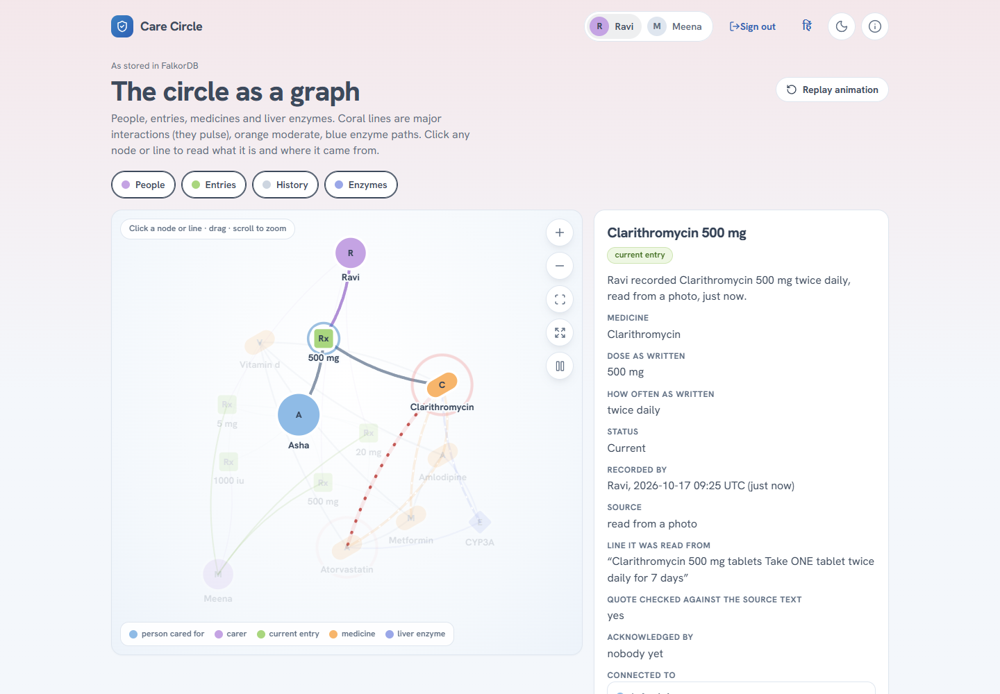
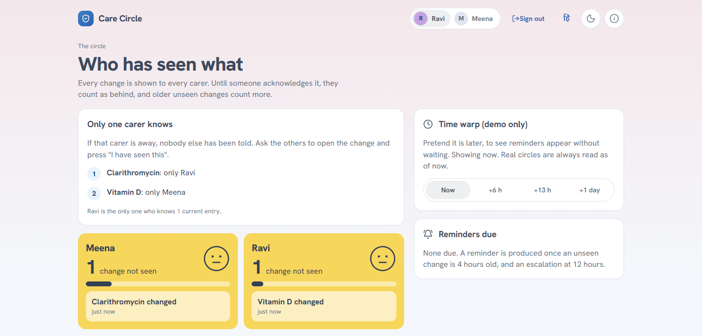
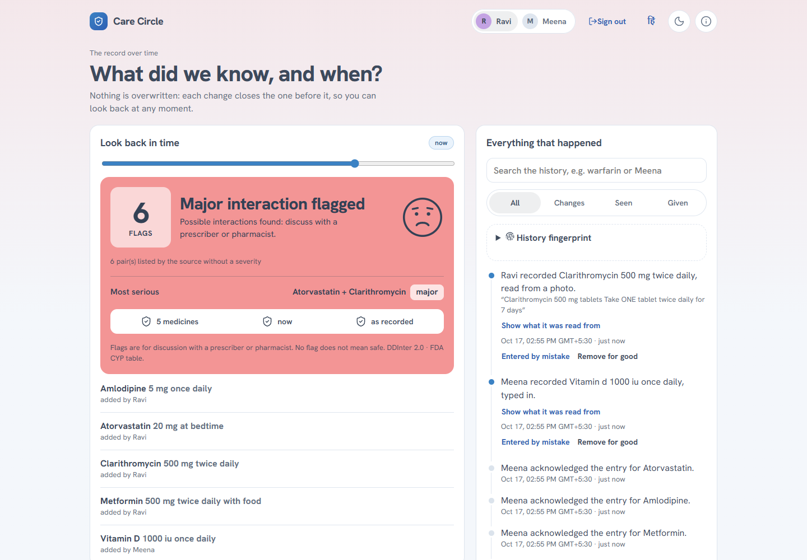

# What it looks like

Taken from the live app at laptop width, with the synthetic demo circle (`scripts/take_screenshots.py` makes them again). The README carries the first two; the rest are here.

**Today.** The day's doses, who marked each, then the verdict and its flag count. The verdict is never "safe".

**Add a medicine.** A label is read by OCR, the exact line each entry came from is quoted, and nothing is saved until a person confirms it.

**Every flag shows its source.** The pair, how severe the source rates it, which source, and the graph pattern behind it. Enzyme paths come from the FDA table and are shown separately.

**The circle as a graph, as stored in FalkorDB.** Carers, entries, medicines and the enzyme; the coral line is the major pair, the dashed blue one an enzyme path.

Click anything and it explains itself in plain words, with the line it was read from:

**Who has seen what.** Every change is shown to every carer; until someone acknowledges it they count as behind, and a medicine only one carer knows about is called out.

**History.** Nothing is overwritten: slide back to see what the record and its flags said at any earlier moment, or read what happened in order, with the line each entry was read from.

## The screens, in a table

| Screen | |
|---|---|
| **Today** | One verdict tile (never "safe"), the regimen, and every flag with its source Cypher or enzyme path. |
| **Add** | A photo, voice note, PDF, Word file or typed text becomes proposals with the exact quoted line; a person confirms each one. |
| **Circle** | Who has seen each change, reminders and escalation, and a once-per-slot dose log that refuses a second "given". |
| **Graph** | The circle as a living graph (people, entries, medicines, enzymes); click anything for a plain-words explanation; cards for what the record hangs on, bridges, groups and a path finder. |
| **History** | A look-back slider (what the flags were), a written timeline, FHIR R4 export, and *forget with a receipt*. |
| **Helper** | Answers from the circle's own record, in English or Hindi; declines to advise and points to a prescriber or pharmacist. |
| **Account** | Sign-in (Amazon Cognito on the live site), invitations, quiet hours, browser notifications, a time-limited read-only link for a pharmacist who can leave a note, and a note of whether the person knows about the record. |
| **Telegram** | The same without the app: photo, voice, text, `/regimen`, `/check`, `/history`, `/ack`, `/gave`. |
